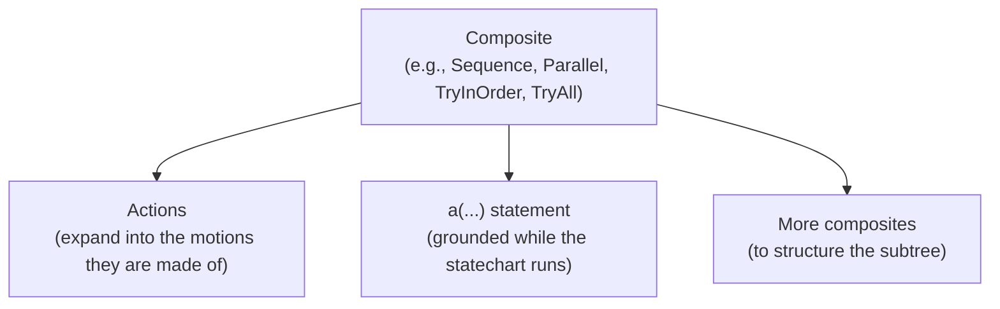

(statechart_header)=

# The CoraPlex Statechart

```{contents}
:local:
:depth: 1
```

## What CoraPlex runs

What a robot does in CoraPlex is a cramph statechart: actions, motions and the composites holding them are nodes of
one statechart, which is compiled once and then ticked. How a statechart works - life cycle and observation states,
transition conditions, composites, ticking and settling - is described in the
[cramph statechart documentation](https://cram2.github.io/cognitive_robot_abstract_machine/cramph/statecharts.html).
That is the same loop Giskard runs motions in, so the actions and the motions they are made of live in one statechart.

The nodes CoraPlex adds to a statechart are usually cramph composites, such as `Sequence`, `Parallel`, `TryInOrder` or
`TryAll`, holding actions, motions and further composites. They are built on their own, before they join a
statechart:

```python
from cramph.composites import Sequence

plan = Sequence(nodes=[ParkArmsAction(arms=robot.all_arms), NavigateAction(target_location=target_pose)])
```

## How the statechart is shaped

Each top-level node is a tree with a composite at the top and actions beneath it:



- Composites define the order and concurrency of their children, and how a failing child affects them.
- Actions expand into the motions they are made of once they join a statechart.
- An `a(...)` statement handed to a composite runs as a `StatementNode`, which grounds it into a concrete action
  against the world as the steps before it left it, each candidate being tried on a copy of the world first.

## Why the statechart matters to CoraPlex

- **One structure for describing and running behaviour.** The statechart a developer writes is the statechart that
  runs, so nothing is translated between a description and its execution, and what ran is what was written.
- **The statechart reacts while it runs.** Monitors pause, resume or cancel parts of it as the world changes, and a
  failing attempt lets a `TryInOrder` move on to the next alternative, without polling for any of it.
- **Actions and motions share one control loop.** Actions expand into giskard goals in the same statechart, so the
  controller sees every motion currently running and every action sees the progress of its motions.
- **The statechart can grow while it runs.** A `StatementNode` grounds its statement only once it is reached, against
  the world as the steps before it left it, and the chosen action joins the running statechart.
- **The statechart is the record of what happened.** Every node keeps its life cycle and observation history, which is
  what visualizations, recordings and the ORM read.
- **It can be sent to the robot.** A statechart serializes to JSON, so the same statechart runs in simulation or is
  sent to Giskard on the real robot.

## Executing a statechart

An executor builds the statechart context the nodes run in, out of the world and the context extensions it is given,
and compiles and executes the statechart, the way a Giskard executor compiles and executes a motion statechart:

```python
from coraplex.plans.context_extensions import RobotAccess
from cramph.context import StatechartContext
from coraplex.plans.executors import KinematicallySimulatedPlanExecutor
from cramph.statechart import Statechart

executor = KinematicallySimulatedPlanExecutor(
    StatechartContext.with_extensions(world, [RobotAccess(robot)])
)
statechart = Statechart(context=executor.context)
statechart.add_node(plan)
executor.compile(statechart)
executor.execute()
```

- The context extensions carry what every node reads from its context, such as the robot performing the actions
  (`RobotAccess`) and how statements are grounded (`StatementGrounding`).
- `compile` adds to the statechart the collision avoidance when the executor is asked for it, and an `EndMotion` that
  ends the statechart once every top-level node succeeded.
- `execute` runs that statechart: a `KinematicallySimulatedPlanExecutor` in simulation, a `RealRobotPlanExecutor` by
  sending it to Giskard on the real robot. It raises `MotionDidNotFinish` if the statechart did not succeed.
- An executor runs one statechart, so every statechart gets an executor of its own.

## Inspecting an executed statechart

Every node of an executed statechart keeps its life cycle state, start and end, so the statechart itself is the record
of what the robot did. It can be drawn with `statechart.visualize()`, and an executed statechart can be stored in a
database through ORMatic like any other node.
