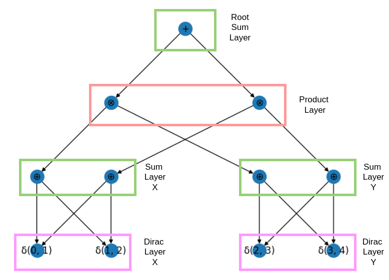

---
jupytext:
  cell_metadata_filter: -all
  formats: md:myst
  text_representation:
    extension: .md
    format_name: myst
    format_version: 0.13
    jupytext_version: 1.11.5
kernelspec:
  display_name: Python 3
  language: python
  name: python3
---

# Representations of Circuits

While understanding the concepts of a probabilistic circuit is subject to math, implementing it is a whole different
story.
This section discusses different approaches to represent circuits.
This package has two implementations: one that stores the circuit as a graph in rustworkx, and one that stores it in
layers, whose arrays belong to any array library.

## The DAG (rustworkx) Way

The easiest and naive way of implementing a circuit is using a directed acyclic graph (DAG).
The graph directly follows definition {prf:ref}`def-probabilistic-circuit`.

Let's look at an example.

```{code-cell} ipython3
import numpy as np
import plotly
plotly.offline.init_notebook_mode()
import plotly.graph_objects as go
import matplotlib.pyplot as plt
from random_events.interval import SimpleInterval
from random_events.variable import Continuous
from probabilistic_model.distributions.uniform import UniformDistribution
from probabilistic_model.probabilistic_circuit.rx.probabilistic_circuit import ProbabilisticCircuit, SumUnit, ProductUnit, leaf


x = Continuous("x")
y = Continuous("y")
model = ProbabilisticCircuit()
sum1, sum2, sum3 = SumUnit(probabilistic_circuit=model), SumUnit(probabilistic_circuit=model), SumUnit(probabilistic_circuit=model)
sum4, sum5 = SumUnit(probabilistic_circuit=model), SumUnit(probabilistic_circuit=model)
prod1, prod2 = ProductUnit(probabilistic_circuit=model), ProductUnit(probabilistic_circuit=model)

sum1.add_subcircuit(prod1, np.log(0.5))
sum1.add_subcircuit(prod2, np.log(0.5))
prod1.add_subcircuit(sum2)
prod1.add_subcircuit(sum4)
prod2.add_subcircuit(sum3)
prod2.add_subcircuit(sum5)

d_x1 = leaf(UniformDistribution(variable=x, interval=SimpleInterval.from_data(0, 1)), probabilistic_circuit=model)
d_x2 = leaf(UniformDistribution(variable=x, interval=SimpleInterval.from_data(2, 3)), probabilistic_circuit=model)
d_y1 = leaf(UniformDistribution(variable=y, interval=SimpleInterval.from_data(0, 1)), probabilistic_circuit=model)
d_y2 = leaf(UniformDistribution(variable=y, interval=SimpleInterval.from_data(3, 4)), probabilistic_circuit=model)

sum2.add_subcircuit(d_x1, np.log(0.8))
sum2.add_subcircuit(d_x2, np.log(0.2))
sum3.add_subcircuit(d_x1, np.log(0.7))
sum3.add_subcircuit(d_x2, np.log(0.3))

sum4.add_subcircuit(d_y1, np.log(0.5))
sum4.add_subcircuit(d_y2, np.log(0.5))
sum5.add_subcircuit(d_y1, np.log(0.1))
sum5.add_subcircuit(d_y2, np.log(0.9))

model.plot_structure()
plt.show()
```

```{code-cell} ipython3
fig = go.Figure(model.plot(), model.plotly_layout())
fig.show()
```

The benefits of the DAG representation are:
- Understandability
- Simplicity of implementation
- Great extendability
- Great for structure learning
- Great for teaching

The drawbacks are:
- Every query visits the nodes one by one in Python, which is slow for large circuits
- Nodes that do the same operation are not computed together, so rustworkx does not benefit from SIMD instructions
  or hardware acceleration the way a layered circuit does


## The Layered Way
Modern literature suggests representing circuits in a way that is compatible with modern hardware
acceleration. {cite}`liu2024scaling`, {cite}`peharz2020einsum`.

Doing so requires a topological sorting of the circuit. In that topological sorting, each layer represents a set of
nodes at the same depth (distance to the root) that can be computed in parallel.
These nodes have to be of the same type, such that their operations (weighted sum, product, density, etc.) can be computed in parallel.

The way a layered circuit is structured is shown in the figure below.



We can see that similar operations have been grouped together.
Now they can be executed as one array operation instead of a for loop in Python.
The benefits of the layered representation are:
- One array operation per layer instead of one Python call per node
- Compatible with modern machine learning frameworks
- Compatible with modern hardware acceleration
- Most likely the future of probabilistic circuits


The drawbacks are:
- Harder to understand
- Harder to maintain
- Harder to extend with new kinds of nodes or to change in structure

The layered implementation answers its numeric queries on NumPy, JAX or PyTorch arrays.

## NumPy Implementation

The NumPy implementation is the `LayeredProbabilisticCircuit` in
`probabilistic_model.probabilistic_circuit.tensorized`.
It answers every query the rustworkx implementation answers, including marginals,
truncation and conditioning, which return a NumPy circuit again.

```{code-cell} ipython3
from random_events.interval import closed
from random_events.product_algebra import SimpleEvent
from probabilistic_model.adapters.rustworkx_tensorized.rustworkx_to_tensorized import RustworkxCircuitToLayeredCircuitConverter

numpy_model = RustworkxCircuitToLayeredCircuitConverter.convert(model)
event = SimpleEvent.from_data({x: closed(0.25, 2.5)}).as_composite_set()
truncation = numpy_model.truncated(event)
print(truncation.probability)

```

## Array Backends and Training

The numeric queries of a layered circuit (log-likelihood, cumulative distribution,
probability of a simple event and moments) run on any array library that implements the
Python Array API standard: NumPy and, with the optional `jax` and `torch` extras, JAX and PyTorch, on
the CPU or a GPU. `to_namespace` copies a circuit to another library, device and floating
point type; the queries then compute in that library and type.

```{code-cell} ipython3
import jax.numpy as jnp

jax_model = numpy_model.to_namespace(jnp)
print(jax_model.log_likelihood(events=jnp.asarray([[0.5], [1.5]])))
```

Under `jax.jit` the log-likelihood compiles into a single function. Structural queries
(support, mode, truncation, conditioning, marginals, simplification) and sampling run on
NumPy only and raise `HostOnlyQueryError` for other parameters; `to_namespace(numpy)`
converts back.

The edges of sum and product layers are stored in an `EdgeMatrix`: `SparseEdgeMatrix`
stores one value per edge, `DenseEdgeMatrix` the whole matrix of a layer. Dense matrices
are faster for layers whose nodes are connected to most of their children, such as the
sum layers of a RAT-SPN, and much slower for sparsely connected ones;
`store_edges_as` converts every inner layer of a circuit.

A circuit with JAX parameters is trained by gradient descent with `fit`, or with
`JaxGradientDescent` from `probabilistic_model.learning.jax_gradient_descent` and a `Loss`
from `probabilistic_model.learning.gradient_descent`; a
circuit with PyTorch parameters with `TorchGradientDescent` from
`probabilistic_model.learning.torch_gradient_descent`. `RegionGraph.to_probabilistic_circuit`
builds a randomly initialized RAT-SPN (Peharz et al., 2019) as a layered circuit with NumPy
parameters, which `to_namespace` moves to JAX or PyTorch for training: fully factorized input distributions in every leaf region, the cross products
of the regions of every partition and fully connected sum layers in every other region. A
RAT-SPN that predicts a symbolic variable, built with
`to_probabilistic_circuit(predicted_variable=...)`, is trained generatively on the joint
likelihood with `fit`, or discriminatively with
`fit(..., loss=CrossEntropy.from_predicted_variable(...))`.

## Which One to Use

| implementation | built for |
| --- | --- |
| rustworkx | trying out new circuit structures, and understanding and developing new algorithms |
| layered | speed: answering queries, including truncation, conditioning and marginals, and learning parameters by gradient descent on any array backend |

`RustworkxCircuitToLayeredCircuitConverter` and `LayeredCircuitToRustworkxCircuitConverter` in
`probabilistic_model.adapters.rustworkx_tensorized` convert between the two, and
`CircuitRepresentations` in `probabilistic_model.adapters.circuit_representations` chains
the converters of whole circuits.

The NumPy circuit is faster than rustworkx for the probability of an event, for
truncation and for conditioning, by between about 2 and 60 times on a joint probability
tree and on Gaussian mixtures, and more the larger the event or the mixture. Rustworkx stays
faster for the likelihood of large batches of events on circuits whose leaves have small,
disjoint supports, like those of a joint probability tree.
`experiments/src/experiments/probabilistic_model_experiments/layered_circuit_speed.py`
and `gaussian_mixture_speed.py` in the same folder measure both.
